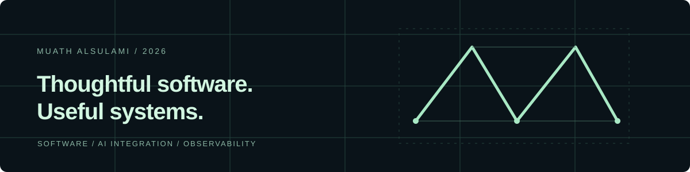

# Muath Alsulami

**Computer Science & AI graduate · Software development · AI integration**

I enjoy turning ideas into useful software, connecting intelligent features to applications, and understanding the systems that keep them running. I graduated from Umm Al-Qura University in 2026 with a **3.54/4.00 GPA and Second Class Honors**.

[Explore my portfolio ↗](https://muathmalsulami.github.io/learn-git-with-pathy/) &nbsp; · &nbsp; [LinkedIn](https://www.linkedin.com/in/muath-m-alsulami/) &nbsp; · &nbsp; [Email](mailto:muath.m.alsulami@gmail.com)

## Selected work

### [Personal portfolio ↗](https://muathmalsulami.github.io/learn-git-with-pathy/)
A bilingual home for my work, built with HTML, CSS and JavaScript. Explore the site or [read the source](https://github.com/muathmalsulami/learn-git-with-pathy). The project uses Git and GitHub workflows; AI-assisted development with OpenAI Codex is disclosed in its README.

### Numoo · university team project
Contributed to application development and integrated AI functionality using Python, Flask and REST/JSON interfaces. My role was application and model integration, **not model training**. The [portfolio project notes](https://muathmalsulami.github.io/learn-git-with-pathy/#work) describe the work; no public source repository is claimed.

## Systems in practice

At the **National Center for Meteorology** in Jeddah, my IT cooperative training included infrastructure and monitoring work with Docker, Docker Compose, Prometheus, Node Exporter, Grafana and Loki. I worked with PromQL and dashboards for CPU, memory, disk and network monitoring.

## Tools I have used

- **Build:** Python · Flask · JavaScript · HTML · CSS · REST/JSON  
- **Systems:** Docker · Prometheus · Grafana · Loki  
- **Workflow:** Git · GitHub

Based in Makkah, Saudi Arabia. Interested in opportunities to build practical software and keep learning.
