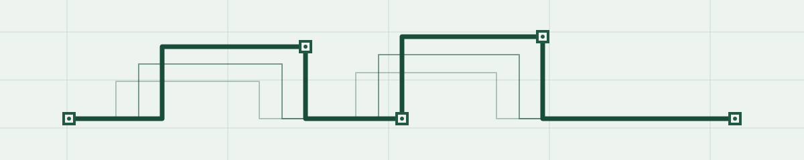
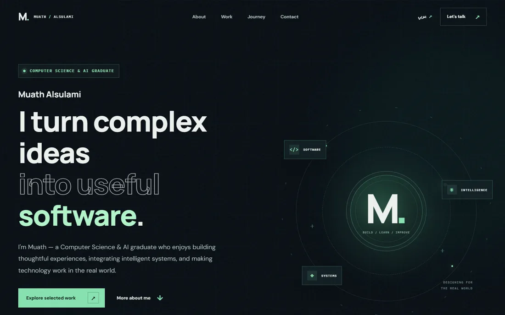

<picture>
  <source media="(prefers-color-scheme: dark)" srcset="assets/signature-dark.svg">
  <source media="(prefers-color-scheme: light)" srcset="assets/signature-light.svg">
  
</picture>

# Muath Alsulami

**Computer Science & AI graduate · Software development · AI integration**

I build applications that connect useful interfaces, software and intelligent features. I care about the details that make a system understandable, maintainable and ready to use.

[**Explore my portfolio ↗**](https://muathmalsulami.github.io/learn-git-with-pathy/) · [LinkedIn](https://www.linkedin.com/in/muath-m-alsulami/) · [Email](mailto:muath.m.alsulami@gmail.com)

## Selected work

### 01 / Personal portfolio

A bilingual space for documenting my projects and experience. Built with **HTML, CSS and JavaScript**, with Git and GitHub supporting versioned changes, branches and review. The image shows the published website, not an experimental identity.

[Visit the live site ↗](https://muathmalsulami.github.io/learn-git-with-pathy/) · [Read the source ↗](https://github.com/muathmalsulami/learn-git-with-pathy)

### 02 / Numoo — application & AI integration

A university team project exploring stock-direction forecasting. I built application interfaces and the **Python/Flask API layer** that connected the team's models to the application; my contribution did not include training the models.

**Evidence:** [Project notes in my portfolio ↗](https://muathmalsulami.github.io/learn-git-with-pathy/#work). The project is presented as team work; no public source repository is claimed.

### 03 / Monitoring & observability

During my **2025 IT cooperative training** at the National Center for Meteorology in Jeddah, I worked on a training-environment monitoring and logging setup. I used **Docker Compose, Node Exporter, Prometheus, Grafana and Loki**, including dashboards, queries and simulated-failure checks.

**Evidence:** [Training overview in my portfolio ↗](https://muathmalsulami.github.io/learn-git-with-pathy/#journey). This describes training work, not a public production system.

## How I build

I use Git and GitHub to keep work traceable through commits, branches and pull requests. I also use AI-assisted development tools as part of the workflow, with review and testing of the resulting changes; the portfolio repository discloses its use of OpenAI Codex.

- **Application:** Python · Flask · JavaScript · HTML · CSS · REST/JSON
- **Systems:** Docker · Prometheus · Grafana · Loki
- **Workflow:** Git · GitHub

## Education & learning

**B.Sc. Computer Science & Artificial Intelligence** — Umm Al-Qura University, 2026
GPA **3.54/4.00**, Second Class Honors.

**Software Project Management (Git & GitHub)** — Pathy, November 2026 · [Verify certificate ↗](https://learn.pathy.live/certificate/PTHYHCR6WZ3G5Q93)

## Connect

Based in Makkah, Saudi Arabia. I am interested in software development, AI integration and opportunities to keep building useful things.

[Portfolio](https://muathmalsulami.github.io/learn-git-with-pathy/) · [LinkedIn](https://www.linkedin.com/in/muath-m-alsulami/) · [Email](mailto:muath.m.alsulami@gmail.com)
