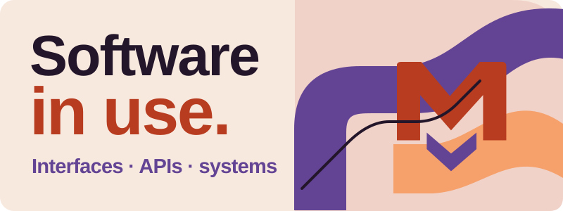
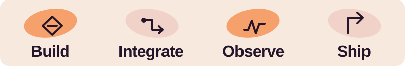

# Muath Alsulami

معاذ السلمي · Makkah, Saudi Arabia

**Software development · AI integration · Observability**

I build the point of contact between people and software, then follow the API and the system signals that make the experience work.

[Selected work](#selected-work) · [Capabilities](#capabilities) · [Journey](#journey)

<picture>
  <source media="(prefers-reduced-motion: no-preference)" srcset="art/hero.svg">
  
</picture>

## Selected work

Project artwork is conceptual.

### Numoo

*Completed university graduation project · Team* · [Numoo case study](https://muathmalsulami.github.io/?case=numoo)

Built the application interfaces and Python/Flask REST API that brought stock-direction predictions from teammates’ models into the app. **Python · Flask · REST/JSON**

### National Center for Meteorology

*Completed IT co-op · Jeddah* · [NCM training case study](https://muathmalsulami.github.io/?case=ncm)

Worked on a co-op monitoring setup using service dashboards, host metrics, PromQL queries and logs. Documented the training work. **Docker Compose · Node Exporter · Prometheus · Grafana · Loki**

### Bilingual portfolio

*Published personal website* · [Visit the site](https://muathmalsulami.github.io/) · [Browse the source](https://github.com/muathmalsulami/muathmalsulami.github.io)

Built and published a bilingual portfolio with case studies and source links so readers can inspect the scope and evidence for each project. **HTML · CSS · JavaScript · Git · GitHub**

## Capabilities

### Build

Turn application requirements into usable web interfaces. 
**Python · Flask · HTML · CSS · JavaScript** · [Numoo](#numoo) and [bilingual portfolio](#bilingual-portfolio)

### Integrate

Connect a user-facing feature to model output through an explicit API. 
**REST APIs · JSON · model-to-application integration** · [Numoo](#numoo)

### Observe

Inspect host metrics, service behavior and logs in a co-op training stack. 
**Docker Compose · Node Exporter · Prometheus · Grafana · Loki · PromQL** · [NCM](#national-center-for-meteorology)

### Ship

Make changes traceable through branches, review, checks and documentation. 
**Git · GitHub · pull requests · CI · technical documentation** · [Profile workflow and evidence](https://github.com/muathmalsulami/muathmalsulami/pull/1)

## Journey

**2026 · Umm Al-Qura University** 
B.Sc. Computer Science & Artificial Intelligence · GPA 3.54/4.00 · Second Class Honors.

**2025 · National Center for Meteorology, Jeddah** 
Completed IT co-op in monitoring and logging. [Training case study](https://muathmalsulami.github.io/?case=ncm)

**2026 · Pathy** 
Software Project Management (Git & GitHub). [Verify the certificate](https://learn.pathy.sa/certificate/PTHYHCR6WZ3G5Q93)

## Current interests

I am interested in practical AI features and the small design choices that make the behavior of a service easier to understand.

## Contact

[Portfolio](https://muathmalsulami.github.io/) · [LinkedIn](https://www.linkedin.com/in/muath-m-alsulami/) · [Email](mailto:muath.m.alsulami@gmail.com)
