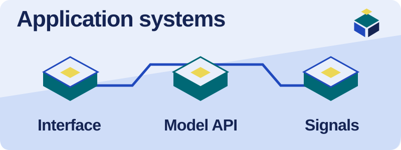
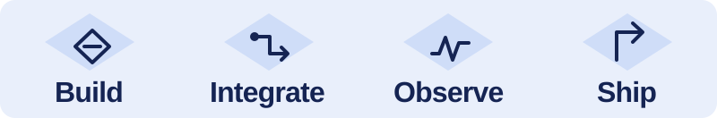

# Muath Alsulami

معاذ السلمي · Makkah, Saudi Arabia

**Application interfaces, model integration and service observability**

I build interfaces, connect them to models through APIs, and inspect service behavior with metrics and logs.

[Engineering capabilities](#engineering-capabilities) · [Selected work](#selected-work) · [Journey](#journey)

<picture>
  <source media="(prefers-reduced-motion: no-preference)" srcset="art/hero.svg">
  
</picture>

## Engineering capabilities

**Build** — Turn application requirements into usable web interfaces. 
Python · Flask · HTML · CSS · JavaScript · [Numoo](#numoo) and [bilingual portfolio](#bilingual-portfolio)

**Integrate** — Connect a user-facing feature to model output through an explicit API. 
REST APIs · JSON · model-to-application integration · [Numoo](#numoo)

**Observe** — Inspect host metrics, service behavior and logs in a co-op training stack. 
Docker Compose · Node Exporter · Prometheus · Grafana · Loki · PromQL · [NCM](#national-center-for-meteorology)

**Ship** — Make changes traceable through branches, review, checks and documentation. 
Git · GitHub · pull requests · CI · technical documentation · [Profile workflow and evidence](https://github.com/muathmalsulami/muathmalsulami/pull/1)

## Selected work

Project artwork is conceptual.

### Numoo

**Completed university graduation project · Team**

> Built the application interfaces and Python/Flask REST API that brought stock-direction predictions from teammates’ models into the app.

**Stack** · Python · Flask · REST/JSON 
**Evidence** · [Numoo case study](https://muathmalsulami.github.io/?case=numoo)

### National Center for Meteorology

**Completed IT co-op · Jeddah**

> Worked on a co-op monitoring setup using service dashboards, host metrics, PromQL queries and logs. Documented the training work.

**Stack** · Docker Compose · Node Exporter · Prometheus · Grafana · Loki 
**Evidence** · [NCM training case study](https://muathmalsulami.github.io/?case=ncm)

### Bilingual portfolio

**Published personal website**

> Built and published a bilingual portfolio with case studies and source links so readers can inspect the scope and evidence for each project.

**Stack** · HTML · CSS · JavaScript · Git · GitHub 
**Evidence** · [Visit the site](https://muathmalsulami.github.io/) · [Browse the source](https://github.com/muathmalsulami/muathmalsulami.github.io)

## Journey

**2026 · Umm Al-Qura University** 
B.Sc. Computer Science & Artificial Intelligence · GPA 3.54/4.00 · Second Class Honors.

**2025 · National Center for Meteorology, Jeddah** 
Completed IT co-op in monitoring and logging. [Training case study](https://muathmalsulami.github.io/?case=ncm)

**2026 · Pathy** 
Software Project Management (Git & GitHub). [Verify the certificate](https://learn.pathy.sa/certificate/PTHYHCR6WZ3G5Q93)

## Current interests

I am interested in traceable model-to-application integrations and observability for small services.

## Contact

[Portfolio](https://muathmalsulami.github.io/) · [LinkedIn](https://www.linkedin.com/in/muath-m-alsulami/) · [Email](mailto:muath.m.alsulami@gmail.com)
