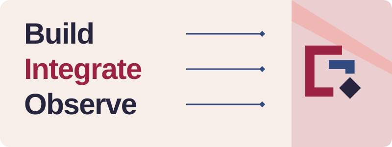
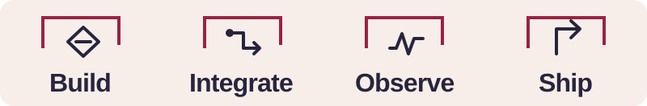

# Muath Alsulami

معاذ السلمي · Makkah, Saudi Arabia

**Software development · AI integration · Observability**

I develop web interfaces and Flask APIs, with practical experience in model integration and monitoring. [Umm Al-Qura University, 2026 · Second Class Honors](#education-and-training).

[Project evidence](#selected-work) · [Capabilities](#capabilities-at-a-glance) · [Education](#education-and-training)

<picture>
  <source media="(prefers-reduced-motion: no-preference)" srcset="art/hero.svg">
  
</picture>

## Capabilities at a glance

| Function | Tools and evidence |
| --- | --- |
| **Build** | Python · Flask · HTML · CSS · JavaScript · [Numoo](#numoo) and [bilingual portfolio](#bilingual-portfolio) |
| **Integrate** | REST APIs · JSON · model-to-application integration · [Numoo](#numoo) |
| **Observe** | Docker Compose · Node Exporter · Prometheus · Grafana · Loki · PromQL · [NCM](#national-center-for-meteorology) |
| **Ship** | Git · GitHub · pull requests · CI · technical documentation · [Profile workflow and evidence](https://github.com/muathmalsulami/muathmalsulami/pull/1) |

## Selected work

Project artwork is conceptual.

### Numoo

**Completed university graduation project · Team** · [Numoo case study](https://muathmalsulami.github.io/?case=numoo)

Built the application interfaces and Python/Flask REST API that brought stock-direction predictions from teammates’ models into the app.

**Tools used** · Python · Flask · REST/JSON

### National Center for Meteorology

**Completed IT co-op · Jeddah** · [NCM training case study](https://muathmalsulami.github.io/?case=ncm)

Worked on a co-op monitoring setup using service dashboards, host metrics, PromQL queries and logs. Documented the training work.

**Tools used** · Docker Compose · Node Exporter · Prometheus · Grafana · Loki

### Bilingual portfolio

**Published personal website** · [Visit the site](https://muathmalsulami.github.io/) · [Browse the source](https://github.com/muathmalsulami/muathmalsulami.github.io)

Built and published a bilingual portfolio with case studies and source links so readers can inspect the scope and evidence for each project.

**Tools used** · HTML · CSS · JavaScript · Git · GitHub

## Education and training

**2026 · Umm Al-Qura University** 
B.Sc. Computer Science & Artificial Intelligence · GPA 3.54/4.00 · Second Class Honors.

**2025 · National Center for Meteorology, Jeddah** 
Completed IT co-op in monitoring and logging. [Training case study](https://muathmalsulami.github.io/?case=ncm)

**2026 · Pathy** 
Software Project Management (Git & GitHub). [Verify the certificate](https://learn.pathy.sa/certificate/PTHYHCR6WZ3G5Q93)

## Current interests

I am interested in application engineering roles involving web development, API integration and systems that can be tested and observed.

## Contact

[Portfolio](https://muathmalsulami.github.io/) · [LinkedIn](https://www.linkedin.com/in/muath-m-alsulami/) · [Email](mailto:muath.m.alsulami@gmail.com)
