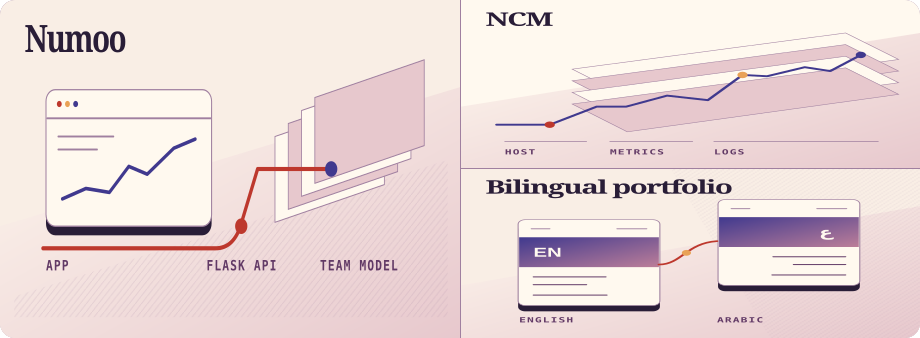
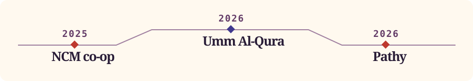

# Muath Alsulami

معاذ السلمي · Makkah, Saudi Arabia

**Software development · AI integration · Observability** 
I build web interfaces and Flask APIs that connect apps to models, then use metrics and logs to understand how services behave.

[**Selected work**](#selected-work) · [Capabilities](#engineering-capabilities) · [Education and experience](#education-and-experience) · [Portfolio](https://muathmalsulami.github.io/)

<picture>
  <source media="(max-width: 600px) and (prefers-reduced-motion: no-preference)" srcset="art/hero-mobile.svg">
  <source media="(max-width: 600px)" srcset="art/hero-mobile-still.svg">
  <source media="(prefers-reduced-motion: no-preference)" srcset="art/hero.svg">
  
</picture>

## Engineering capabilities

<picture>
  <source media="(max-width: 600px)" srcset="art/capabilities-mobile.svg">
  
</picture>

| Engineering function | Where I applied it |
| --- | --- |
| **Build** | HTML, CSS and JavaScript for the [bilingual portfolio](#bilingual-portfolio). |
| **Integrate** | Python, Flask and REST/JSON for the [Numoo application](#numoo). |
| **Observe** | Docker Compose, Node Exporter, Prometheus, Grafana, Loki and PromQL in [co-op training](#national-center-for-meteorology). |
| **Ship** | Git branches, pull requests, CI and review evidence in the [profile workflow](https://github.com/muathmalsulami/muathmalsulami/pull/1). |

## Selected work

<picture>
  <source media="(max-width: 600px)" srcset="art/work-mobile.svg">
  
</picture>

*Conceptual artwork showing the roles of the systems.*

### Numoo

**Completed university graduation project · Team** 
Built the application interfaces and Python/Flask REST API for a stock-direction forecasting prototype. The API exposed predictions from models trained by other team members. [Numoo case study](https://muathmalsulami.github.io/?case=numoo)

### National Center for Meteorology

**Completed IT co-op · Jeddah** 
Worked with Docker Compose, Node Exporter, Prometheus, Grafana and Loki in a training setup. Used host metrics, dashboards, PromQL and logs, and documented the training work. [NCM training case study](https://muathmalsulami.github.io/?case=ncm)

### Bilingual portfolio

**Published personal website** 
Built an Arabic and English site with HTML, CSS and JavaScript, using Git and GitHub to track changes. It provides project context, contribution summaries and evidence. [Live portfolio](https://muathmalsulami.github.io/) · [Public source](https://github.com/muathmalsulami/muathmalsulami.github.io)

## Education and experience

**2025 · National Center for Meteorology** · IT cooperative training in monitoring and logging, Jeddah. 
**2026 · Umm Al-Qura University** · B.Sc. Computer Science & Artificial Intelligence · **3.54/4.00, Second Class Honors**. 
**2026 · Pathy** · Software Project Management (Git & GitHub). [Verify the certificate](https://learn.pathy.sa/certificate/PTHYHCR6WZ3G5Q93)

## Contact

[Portfolio](https://muathmalsulami.github.io/) · [LinkedIn](https://www.linkedin.com/in/muath-m-alsulami/) · [Email](mailto:muath.m.alsulami@gmail.com)
